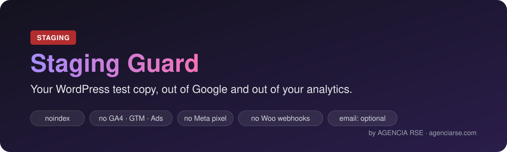
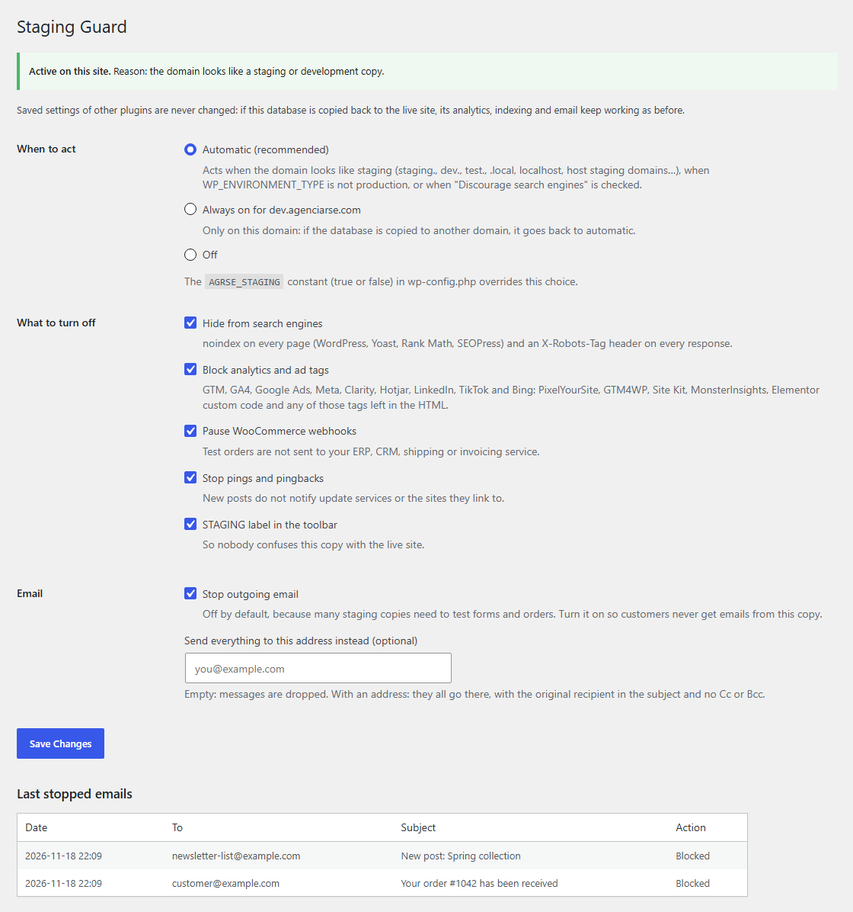
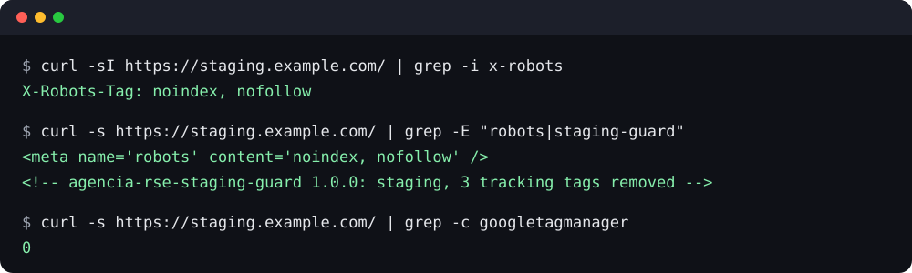

<p align="center">
  <a href="https://agenciarse.com/en/custom-software/wordpress-plugins/staging-guard/"></a>
</p>

<p align="center">
  <a href="https://github.com/agenciaRSE/agencia-rse-staging-guard/releases/latest"></a>
  
  
  <a href="LICENSE"></a>
</p>

<p align="center">
  <strong><a href="https://agenciarse.com/en/custom-software/wordpress-plugins/staging-guard/">Plugin page</a></strong> ·
  <a href="https://agenciarse.com/software-a-medida/plugins-wordpress/staging-guard/">Página en español</a> ·
  <a href="#español">Resumen en español</a>
</p>

# Agencia RSE Staging Guard

A WordPress plugin for **staging, development and local copies** of a site. It keeps the copy out of search engines and stops the live site's analytics, ad tags, WooCommerce webhooks and pings, without changing a single saved setting. Email is left alone unless you ask: then it is dropped or redirected to one address.

## Why

A staging copy cloned from the live site takes everything with it: the Google Tag Manager container, GA4, Google Ads conversions, the Meta pixel, WooCommerce webhooks and every email the site sends.

Those tags **count even on a different domain**. GA4 does not filter by hostname by default, and GTM fires its tags wherever the container loads. We saw it on the staging copy of a site we maintain: test visits went into the client's real GA4, and tests that reached the thank-you page could fire the Google Ads conversion.

Turning the tracking plugins off on the copy is not the answer: those changes live in the database, so they travel back to production when you push the copy live. Staging Guard does everything **with filters at run time** and saves nothing in other plugins' settings.

## What it does

| Feature | Default | Details |
|---|---|---|
| **Hide from search engines** | On | `noindex, nofollow` on every page (WordPress core, Yoast SEO, Rank Math, SEOPress) and an `X-Robots-Tag: noindex, nofollow` header on every PHP response, including feeds, sitemaps, REST and AJAX. |
| **Block analytics and ad tags** | On | PixelYourSite, GTM4WP, Site Kit, MonsterInsights and Elementor Pro custom code. As a safety net, any `<script>` or `<noscript>` with Google Tag Manager, Google Analytics, Google Ads, Meta, Microsoft Clarity, Hotjar, LinkedIn, TikTok or Bing is removed from the final HTML (JSON-LD is kept). |
| **Pause WooCommerce webhooks** | On | Test orders do not reach your ERP, CRM, shipping or invoicing service. |
| **Stop pings and pingbacks** | On | New posts do not notify update services or the sites they link to. |
| **STAGING label** | On | A red label in the admin toolbar, so nobody confuses the copy with the live site. |
| **Stop outgoing email** | **Off** | Off by default because staging is often where you test forms and orders. When on, messages are dropped, or all sent to one address with the original recipient in the subject and no Cc/Bcc. The last 20 stopped emails are listed. |

Everything lives in **Tools → Staging Guard**, with a status box that tells you whether the plugin is acting on this site and why.

<p align="center">
  
</p>

## It does nothing on a live site

In **Automatic** mode (the default) it only acts when at least one of these is true:

- the domain looks like a test copy: `staging.`, `stage.`, `stg.`, `dev.`, `test.`, `demo.`, `preprod.` and similar, `localhost`, an IP address, `.local`, `.test`, `.ddev.site`, `.lndo.site`, or the staging domains of WP Engine, Kinsta, Pantheon, Flywheel, Cloudways, WordPress.com, InstaWP, TasteWP, SiteGround (`sg-host.com`) and GoDaddy (`myftpupload.com`);
- `WP_ENVIRONMENT_TYPE` is `staging`, `development` or `local`;
- "Discourage search engines from indexing this site" is ticked in *Settings → Reading*.

If the plugin is active on a domain that looks live (for example, after pushing staging to production), it stays idle and shows a dashboard warning so you can deactivate it.

Other modes:

- **Always on for _this domain_**: the domain is saved with the choice. If the database is copied to another domain, the plugin falls back to automatic.
- **Off**.
- The `AGRSE_STAGING` constant in `wp-config.php` overrides everything:

```php
define( 'AGRSE_STAGING', true );  // always act on this install
define( 'AGRSE_STAGING', false ); // never act
```

`robots.txt` is left open on purpose: if search engines cannot crawl the pages, they cannot see the `noindex` either, and may still index the URLs if someone links to them.

## Install

1. Download the zip from the [latest release](https://github.com/agenciaRSE/agencia-rse-staging-guard/releases/latest).
2. On the **staging copy**, go to *Plugins → Add New → Upload Plugin*, upload the zip and activate it.
3. Open *Tools → Staging Guard* and check the status box.
4. Clear the page cache, so the noindex and the tag blocking also reach cached pages.

Requires WordPress 5.7+ and PHP 7.2+. No external requests, no visitor data.

## Check that it works

<p align="center">
  
</p>

In the browser, **accept cookies and click or scroll first**: plugins such as WP Rocket delay JavaScript until the first interaction, so looking too early proves nothing. Then run this in the console:

```js
performance.getEntriesByType('resource').map(e => e.name)
  .filter(n => /googletagmanager|google-analytics|facebook|doubleclick|clarity|hotjar/.test(n))
```

It must return `[]`. Run the same test on the live site as a control: there, those requests must appear. GA4's real-time report is a good final check.

## FAQ

**Does it change my analytics or SEO plugin settings?**
No. It never writes to other plugins' options. Deactivate it, or push the copy live, and everything is as it was.

**Does it block email sent through an SMTP plugin?**
It uses WordPress's `pre_wp_mail` filter, which WP Mail SMTP and anything that sends through `wp_mail()` respect. An SMTP plugin that replaces `wp_mail()` with its own copy may skip it; in that case, use that plugin's own "disable email" option.

**Can I test analytics on staging?**
Untick *Block analytics and ad tags*. The noindex stays on.

**What happens on uninstall?**
Deleting the plugin from the Plugins screen removes its settings and the email log.

## Development

- Code: a single file, [`agencia-rse-staging-guard.php`](agencia-rse-staging-guard.php). Strings are in English and translatable (text domain `agencia-rse-staging-guard`).
- Spanish translation for translate.wordpress.org: `python wporg-i18n/build_po.py` (aborts if a string is missing).
- Package for WordPress.org: copy `agencia-rse-staging-guard.php`, `uninstall.php`, `readme.txt` and `LICENSE` into a folder named `agencia-rse-staging-guard` and zip that folder (no `README.md`, `.github/` or `wporg-i18n/`).
- Tested with WordPress 7.1 and PHP 8.2; passes [Plugin Check](https://wordpress.org/plugins/plugin-check/) with no errors.

Issues and pull requests are welcome.

---

## Español

**Staging Guard** es un plugin gratuito de WordPress para **copias de staging, desarrollo y local**. Más información en la [página del plugin](https://agenciarse.com/software-a-medida/plugins-wordpress/staging-guard/).

Una copia clonada de la web real se lleva GTM, GA4, Google Ads, el píxel de Meta, los webhooks de WooCommerce y el correo, y **todo eso cuenta aunque el dominio sea otro**. Staging Guard lo corta en la copia con filtros, sin tocar ningún ajuste guardado, así que puedes volver a subirla a producción tal cual.

- **Activado por defecto:** noindex en toda la web y cabecera `X-Robots-Tag`, bloqueo de la medición y la publicidad (GTM, GA4, Ads, Meta, Clarity, Hotjar, LinkedIn, TikTok, Bing), pausa de los webhooks de WooCommerce y de los pings, y etiqueta STAGING en la barra.
- **Correo, opcional:** viene desactivado. Si lo activas, los mensajes se descartan o se mandan todos a una dirección, con el destinatario original en el asunto.
- **No actúa en producción:** solo trabaja si el dominio parece de pruebas, si `WP_ENVIRONMENT_TYPE` no es `production` o si está marcado «Disuadir a los motores de búsqueda». Si llega a la web real, no hace nada y avisa.
- **Ajustes** en *Herramientas → Staging Guard*. La constante `AGRSE_STAGING` en `wp-config.php` manda sobre todo.

Instalación: descarga el zip de la [última versión](https://github.com/agenciaRSE/agencia-rse-staging-guard/releases/latest), súbelo en *Plugins → Añadir nuevo → Subir plugin* **en el staging**, actívalo y vacía la caché.

---

<p align="center">
  Made by <a href="https://agenciarse.com/">AGENCIA RSE</a>. We also build <a href="https://agenciarse.com/en/custom-software/wordpress-plugins/">custom WordPress plugins</a>.<br>
  License: <a href="LICENSE">GPLv2 or later</a>.
</p>
